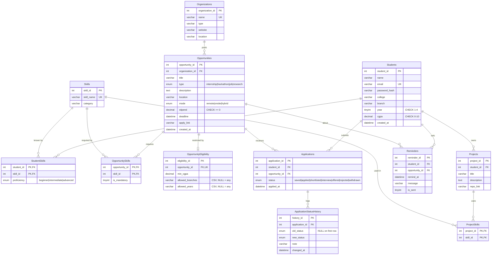

# ER Diagram — OpportunityHub + SkillPath

Render with any Mermaid viewer (GitHub, VS Code "Markdown Preview Mermaid", mermaid.live).

**Relationship summary**

| Relationship | Cardinality | Implemented by |
|---|---|---|
| Students — Skills | M:N | `StudentSkills` (+ `proficiency`) |
| Opportunities — Skills | M:N | `OpportunitySkills` (+ `is_mandatory`) |
| Projects — Skills | M:N | `ProjectSkills` |
| Students — Opportunities | M:N | `Applications` (+ `status`, `applied_at`), `UNIQUE(student_id, opportunity_id)` |
| Organizations — Opportunities | 1:N | `Opportunities.organization_id` |
| Opportunities — Eligibility | 1:0..1 | `OpportunityEligibility.opportunity_id UNIQUE` |
| Applications — History | 1:N | `ApplicationStatusHistory.application_id` |
| Students — Projects / Reminders | 1:N | FK on the child |